# Single-Cell Reanalysis of HSV Infection with R/Seurat

## Data source

### Paper and author-deposited data

- **[Original paper — Lebratti et al. (2021)](https://elifesciences.org/articles/65762)** — Experimental methods, Figure 3 and the stated PMN markers.
- **[GEO: GSE161336](https://www.ncbi.nlm.nih.gov/geo/query/acc.cgi?acc=GSE161336)** — Seven processed single-cell UMI matrices, with barcodes and gene features: mock and HSV-1/HSV-2 at days 1, 3 and 5.
- **[ENA / SRA: PRJNA677918](https://www.ebi.ac.uk/ena/browser/view/PRJNA677918)** — Author-deposited sequencing files and run metadata from the same study. We used these for read-count summaries and viral-alignment checks.
- **[Figure 3 source data 1](https://cdn.elifesciences.org/articles/65762/elife-65762-fig3-data1-v1.xlsx)** — Supplementary neutrophil differential-expression results and Figure 3E IFN-beta ELISA measurements. These were downloaded for reference. Figure 3E is outside this report's current scope.

### Additional sources used in our analysis

- **[MSigDB: Hallmark IFN-alpha response](https://www.gsea-msigdb.org/gsea/msigdb/mouse/geneset/HALLMARK_INTERFERON_ALPHA_RESPONSE)** — The paper names this gene set. We downloaded a current mouse version for Figure 3D scoring (89/94 genes matched). Its equivalence to the paper's historical version is unverified.
- **[PanglaoDB markers](https://panglaodb.se/markers.html)** — Additional candidate markers for other myeloid, epithelial and lymphocyte clusters. These annotations remain provisional.
- **NCBI viral references: [HSV-1 NC_001806.2](https://www.ncbi.nlm.nih.gov/nuccore/NC_001806.2) and [HSV-2 JN561323.2](https://www.ncbi.nlm.nih.gov/nuccore/JN561323.2)** — Reference records we identified from the deposited BAM headers. These accessions are not explicitly named in the paper's methods.

---

## High-level steps

1. **Preprocess**
   - Load and combine the seven samples.
   - Filter high-mitochondrial cells and low-gene clusters, then review sample QC.
2. **Prepare**
   - Normalize counts and select highly variable genes.
   - Regress total UMI, scale and run PCA.
3. **Clustering**
   - Build the neighbor graph, cluster cells and plot t-SNE.
   - Annotate cell types with markers and compare conditions.
   - Plot IFN-alpha response scores.

---

## Step-by-step reproduction

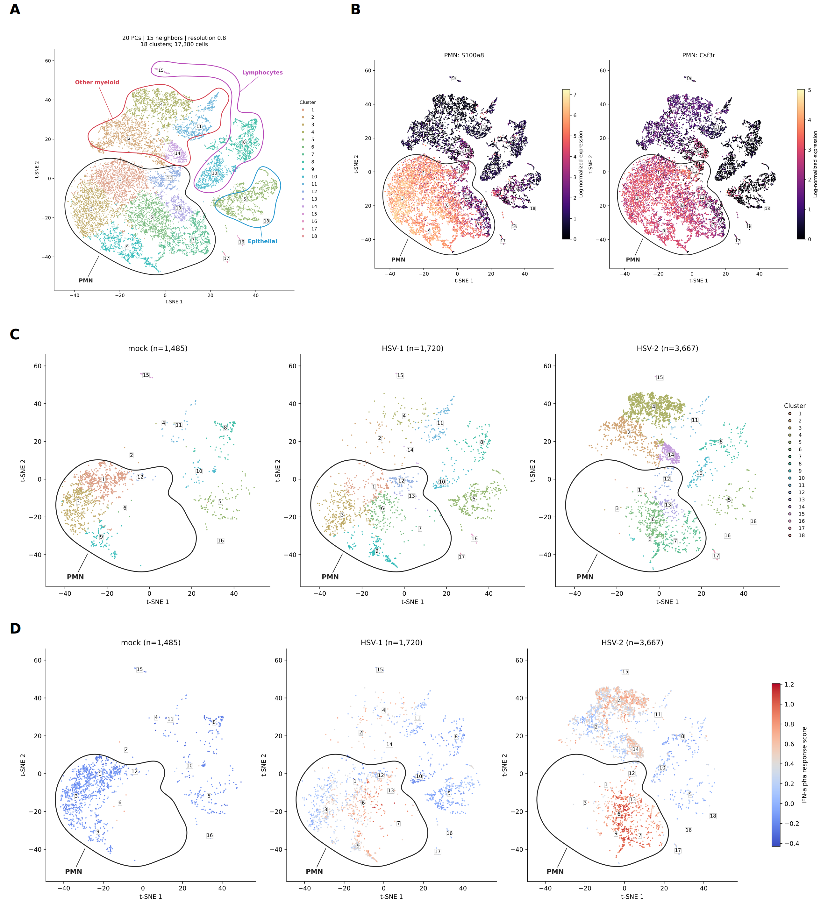

> ### 1. Preprocess

#### 1.1 Load the seven samples

Combine mock and HSV-1/HSV-2 samples at days 1, 3 and 5: **25,233 cells** and **31,055 features**.

#### 1.2 Filter low-quality cells

1. Remove cells with >5% mitochondrial UMI: **20,795 cells remain**.
2. Normalize, select 3,000 HVGs, scale and run initial clustering with **30 PCs, 15 neighbors and resolution 0.5**.
3. Remove clusters with median detected genes <500: **17,380 cells remain**.

##### Per-sample QC summary

<table>
  <thead>
    <tr><th rowspan="2">Sample</th><th rowspan="2">Condition</th><th rowspan="2">Total reads (ENA)</th><th colspan="3">Before QC</th><th colspan="3">After QC (Seurat)</th></tr>
    <tr><th>Cells</th><th>UMI</th><th>Median mouse genes/cell</th><th>Cells</th><th>UMI</th><th>Median mouse genes/cell</th></tr>
  </thead>
  <tbody>
    <tr><td>GSM4905024</td><td>mock</td><td>349,393,689</td><td>2,119</td><td>11,217,519</td><td>1,153.0</td><td>1,485</td><td>8,674,113</td><td>1,239.0</td></tr>
    <tr><td>GSM4905025</td><td>HSV-1 day 1</td><td>329,855,668</td><td>2,764</td><td>18,485,658</td><td>1,145.5</td><td>1,491</td><td>12,427,504</td><td>1,393.0</td></tr>
    <tr><td>GSM4905026</td><td>HSV-2 day 1</td><td>364,128,507</td><td>3,300</td><td>22,356,332</td><td>1,188.0</td><td>2,196</td><td>15,955,237</td><td>1,330.5</td></tr>
    <tr><td>GSM4905027</td><td>HSV-1 day 3</td><td>372,867,577</td><td>4,715</td><td>45,165,593</td><td>1,968.0</td><td>3,549</td><td>38,653,781</td><td>2,302.0</td></tr>
    <tr><td>GSM4905028</td><td>HSV-2 day 3</td><td>414,947,993</td><td>4,318</td><td>22,374,708</td><td>1,059.0</td><td>3,272</td><td>19,886,678</td><td>1,247.5</td></tr>
    <tr><td>GSM4905029</td><td>HSV-1 day 5</td><td>371,353,516</td><td>3,488</td><td>17,709,707</td><td>567.0</td><td>1,720</td><td>13,279,914</td><td>1,272.5</td></tr>
    <tr><td>GSM4905030</td><td>HSV-2 day 5</td><td>363,058,503</td><td>4,529</td><td>37,440,142</td><td>1,656.0</td><td>3,667</td><td>34,540,391</td><td>1,984.0</td></tr>
    <tr><td><strong>Total</strong></td><td></td><td><strong>2,565,605,453</strong></td><td><strong>25,233</strong></td><td><strong>174,749,659</strong></td><td>—</td><td><strong>17,380</strong></td><td><strong>143,417,618</strong></td><td>—</td></tr>
  </tbody>
</table>

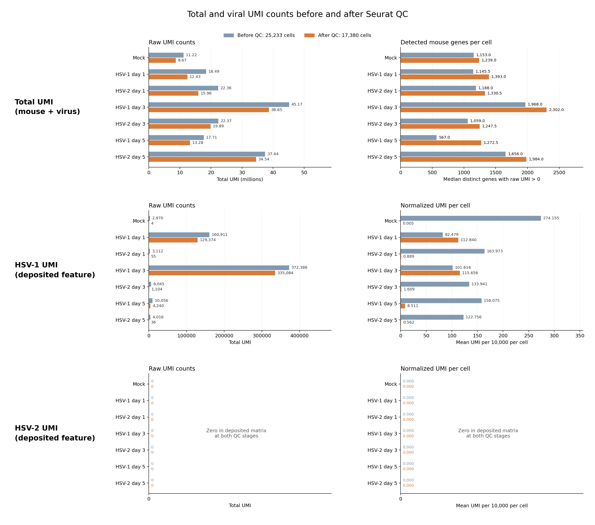

Raw and normalized UMI, and detected mouse genes per cell, before and after QC.

 

> ### 2. Prepare

Start with the **17,380 retained cells**, keeping their original counts across all features. Recompute HVGs after QC because removing cells changes the expression variability across cells. [paper methods, p.18](https://elifesciences.org/articles/65762.pdf#page=18).

#### 2.1 Normalize counts

For every feature in every cell, Seurat's `NormalizeData(scale.factor = 10000)` performs:

1. Divide the feature's UMI count by that cell's total UMI across **all features**, not just HVGs.
2. Multiply by **10,000**, the reference total specified by the paper.
3. Apply the natural-log transformation **`log1p(x) = ln(1 + x)`**.

`normalized expression = ln(1 + 10,000 × feature UMI / total cell UMI)`

#### 2.2 Select highly variable genes

Use `FindVariableFeatures(selection.method = 'mean.var.plot')` across the retained cells from all seven samples:

1. Calculate each feature's average expression and dispersion.
2. Group features into **20 expression bins** and standardize dispersion within each bin, comparing genes with similar average expression.
3. Rank by `mvp.dispersion.scaled` and explicitly select the **top 3,000 HVGs** for regression and PCA.

#### 2.3 Regress total UMI and scale

For each HVG, model its **raw UMI counts** against each cell's total UMI (`nCount_RNA`), using `ScaleData(model.use = 'negbinom', use.umi = TRUE)`. This aims to reduce variation associated with total UMI. Infection condition is not included as a regression covariate.

#### 2.4 Run PCA

Use `RunPCA` on the adjusted **3,000 HVGs**, computing **50 principal components** with seed **42**. Each PC summarizes a weighted combination of genes. Each cell receives a score on each PC. Use the **first 20 PCs** for the final neighbor graph and t-SNE. Computing 50 allows inspection with an elbow plot. The choice of 20 PCs is specific to this analysis. The paper does not report an exact value.

 

> ### 3. Clustering

#### 3.1 Cluster and visualize cells — Figure 3A

Build the shared-nearest-neighbor (SNN) graph with **20 PCs and 15 neighbors**, then run Leiden at **resolution 0.8**, producing **18 clusters**. Use the selected PCs for t-SNE.

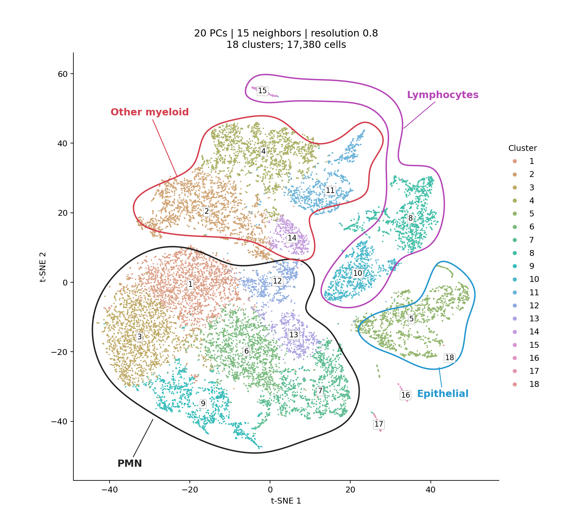

| Candidate type | R cluster IDs |
|---|---|
| PMN | 1, 3, 6, 7, 9, 12, 13 |
| Other myeloid | 2, 4, 11, 14 |
| Epithelial | 5, 18 |
| Lymphocytes | 8, 10, 15 |

Clusters **16 and 17** remain unassigned. All annotations are provisional. Outlines are visual guides rather than exact boundaries. The connected lymphocyte outline does not imply a trajectory. Extra marker panels outline the relevant type. Figures 3C/D outline PMN only.

#### 3.2 Annotate cell types — Figure 3B

Markers are used to interpret clusters after clustering. The paper specifies **S100a8/Csf3r** for neutrophils. The additional candidate markers support provisional annotations of other cell types.

##### Selected markers

| Group         | Selected markers                                                 |
| ------------- | ---------------------------------------------------------------- |
| PMN           | S100a8, Csf3r                                                    |
| Other myeloid | Csf1r, Fcgr1 (monocytes/macrophages), Cd74, Flt3 (DC assessment) |
| Epithelial    | Epcam, Krt5, Krt14, Krt18                                        |
| Lymphocytes   | Cd3d, Cd3e (T), Ncr1, Klrd1 (NK)                                 |

S100a8 and Csf3r log-normalized expression, with cluster IDs on both panels.

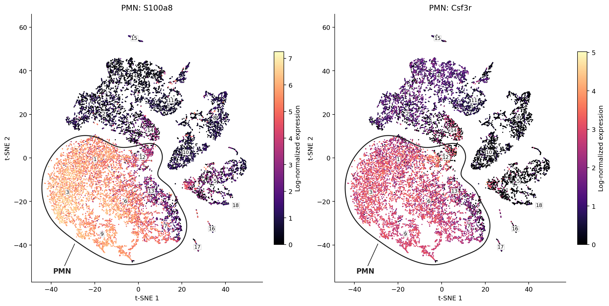

##### Extra: Markers for other cell types

**Other myeloid cells:** Csf1r, Fcgr1, Cd74 and Flt3.

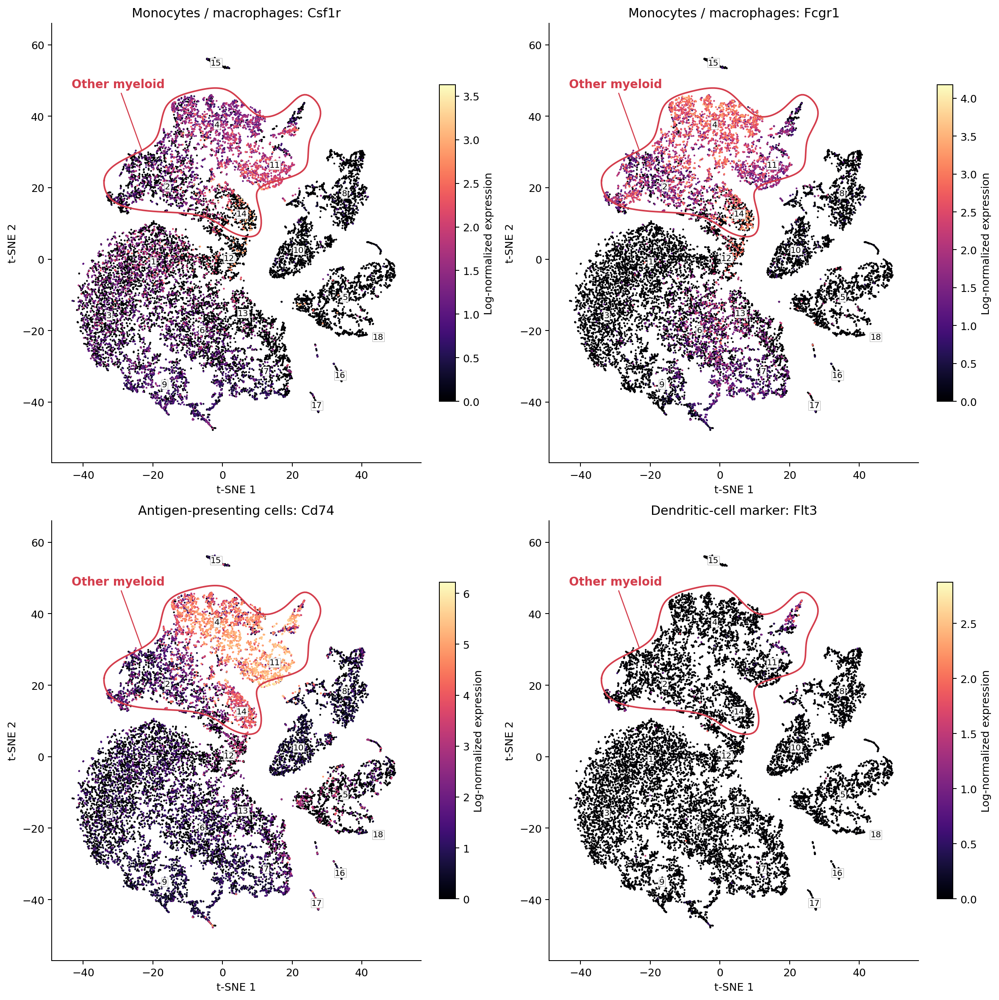

**Epithelial cells:** Epcam, Krt5, Krt14 and Krt18.

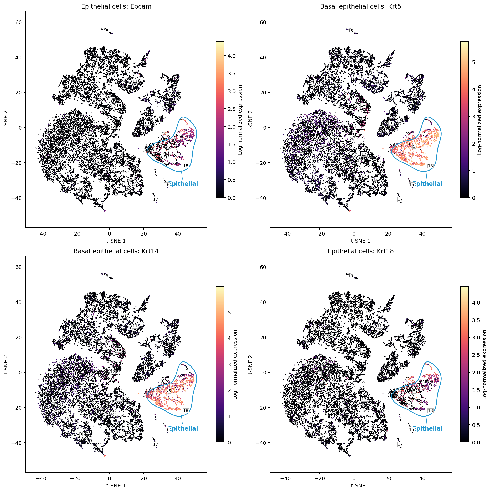

**Lymphocytes:** Cd3d/Cd3e for T cells, Ncr1/Klrd1 for NK cells.

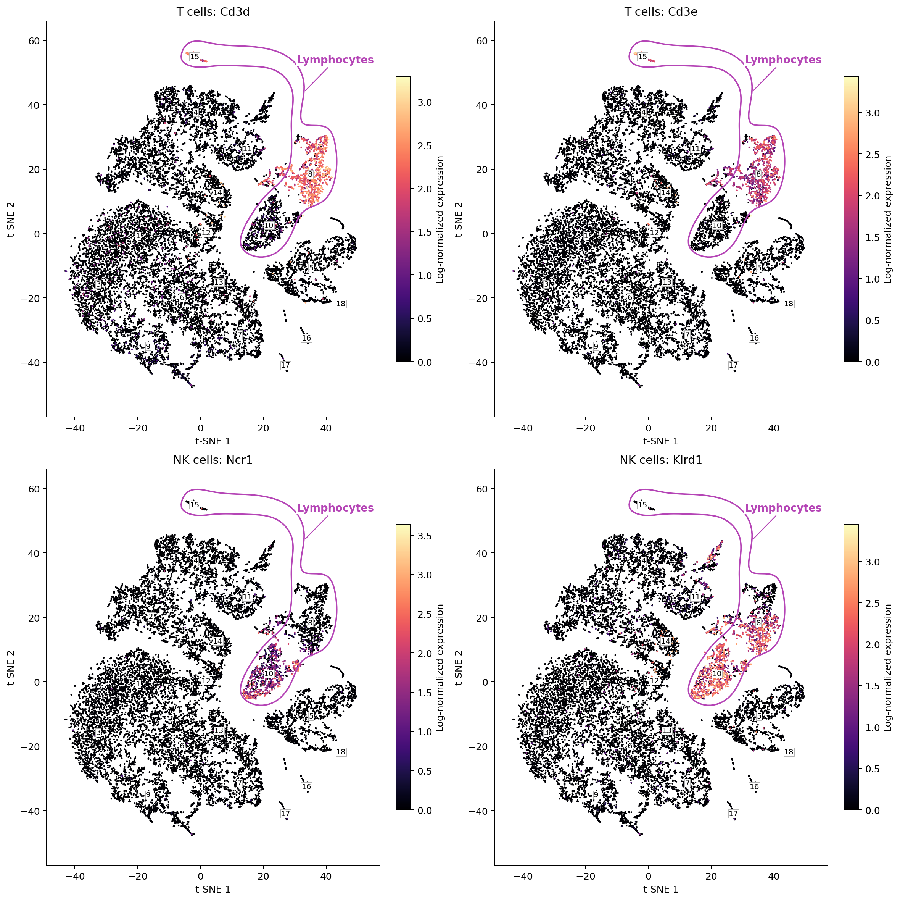

#### 3.3 Compare conditions — Figure 3C

Display mock and day-5 HSV-1/HSV-2 cells on the shared seven-sample t-SNE, without reclustering.

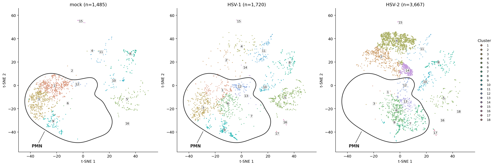

#### 3.4 Score the IFN-alpha response — Figure 3D

The same conditions colored by IFN-alpha response score.

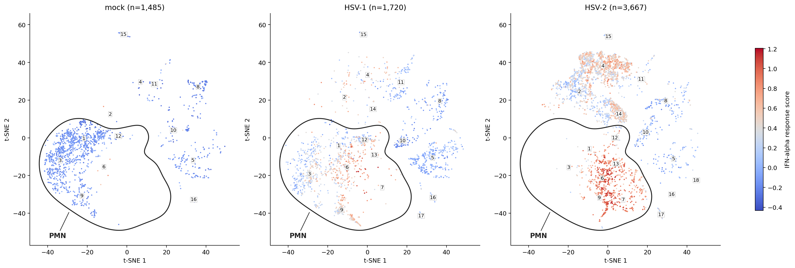

---

## Questions and answers

### Sample-quality questions

The per-sample values are listed in **Step 1.2, Per-sample QC summary**.

| Question | Answer |
|---|---|
| What is the total read count? | ENA reports 2,565,605,453 reads across the seven runs. These archive counts are distinct from UMI counts. |
| How many reads remain after QC? | Not calculated. We report UMI counts before and after our cell QC instead. Read counts after cell QC would require matching BAM reads to retained cell barcodes. |
| How many cells and UMIs remain after QC? | Cells: 25,233 → 17,380. Total UMI: 174,749,659 → 143,417,618. |

Here, “before QC” means before our Seurat filtering. The deposited matrices have already undergone Cell Ranger cell calling.

### Q1. What reference genomes did they use?

The paper specifies **S100a8/Csf3r** as neutrophil markers and examines **Cxcl10, Gbp2 and Il15**. The expression matrix contains only two viral features, **`HSV__HSV1` and `HSV__HSV2`**, without individual viral gene names.

The table distinguishes these markers and features from the alignment references. GEO names the combined reference **`mm10_and_HSV`**, and the inspected BAM headers identify its viral sequences. [GEO processing metadata](https://www.ncbi.nlm.nih.gov/geo/query/acc.cgi?acc=GSM4905028).

| Category | Reference or genes | Description |
|---|---|---|
| Mouse reference | mm10 | Mouse component of the combined alignment reference |
| HSV-1 reference | [NC_001806.2](https://www.ncbi.nlm.nih.gov/nuccore/NC_001806.2), strain 17 | BAM reference `HSV__NC_001806.2` |
| HSV-2 reference | [JN561323.2](https://www.ncbi.nlm.nih.gov/nuccore/JN561323.2), strain HG52 | BAM reference `HSV__JN561323.2` |
| Neutrophil markers | S100a8, Csf3r | Mouse genes used to identify PMN |
| Host-response genes | Cxcl10, Gbp2, Il15 | Mouse genes examined in the paper |
| Viral matrix features | HSV__HSV1, HSV__HSV2 | Two feature labels without individual viral gene names |

### Q2. How many cells in each sample were infected?

The paper does not provide a cell-level infection definition or counts. I temporarily defined **viral UMI >0** as positive and summarized the numbers and percentages of positive cells before and after QC.

<table>
  <thead>
    <tr><th rowspan="2">Sample</th><th rowspan="2">Condition</th><th colspan="2">Before QC</th><th colspan="2">After QC (Seurat)</th></tr>
    <tr><th>HSV-1 positive, n (%)</th><th>HSV-2 positive, n (%)</th><th>HSV-1 positive, n (%)</th><th>HSV-2 positive, n (%)</th></tr>
  </thead>
  <tbody>
    <tr><td>GSM4905024</td><td>mock</td><td>208 (9.82%)</td><td>0 (0.00%)</td><td>2 (0.13%)</td><td>0 (0.00%)</td></tr>
    <tr><td>GSM4905025</td><td>HSV-1 day 1</td><td>1,502 (54.34%)</td><td>0 (0.00%)</td><td>847 (56.81%)</td><td>0 (0.00%)</td></tr>
    <tr><td>GSM4905026</td><td>HSV-2 day 1</td><td>216 (6.55%)</td><td>0 (0.00%)</td><td>10 (0.46%)</td><td>0 (0.00%)</td></tr>
    <tr><td>GSM4905027</td><td>HSV-1 day 3</td><td>3,598 (76.31%)</td><td>0 (0.00%)</td><td>2,804 (79.01%)</td><td>0 (0.00%)</td></tr>
    <tr><td>GSM4905028</td><td>HSV-2 day 3</td><td>530 (12.27%)</td><td>0 (0.00%)</td><td>301 (9.20%)</td><td>0 (0.00%)</td></tr>
    <tr><td>GSM4905029</td><td>HSV-1 day 5</td><td>325 (9.32%)</td><td>0 (0.00%)</td><td>99 (5.76%)</td><td>0 (0.00%)</td></tr>
    <tr><td>GSM4905030</td><td>HSV-2 day 5</td><td>222 (4.90%)</td><td>0 (0.00%)</td><td>11 (0.30%)</td><td>0 (0.00%)</td></tr>
  </tbody>
</table>

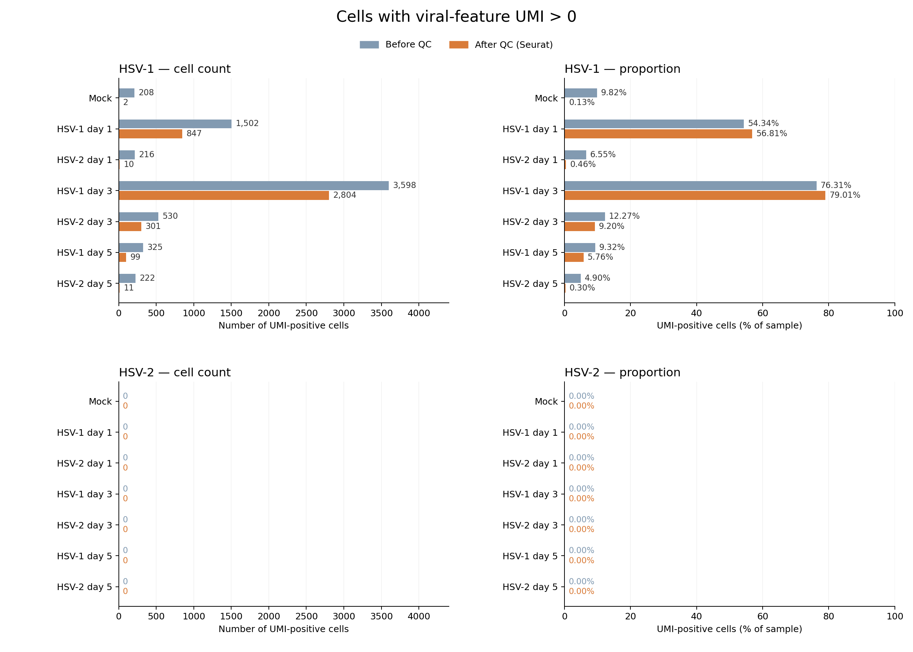

Percentages use all cells in the sample at the corresponding QC stage. Viral UMI positivity is a provisional infection proxy. The unexplained HSV-2 zeros and positive counts in mock are discussed in the gap analysis.

### Q3. What percentage of each infected cell's reads came from the virus?

I calculated the **median viral UMI percentage among positive cells** for each sample. Each cell's percentage is `100 × viral UMI / total cell UMI`. This measures UMI percentage rather than read percentage. N/A means no cells were positive for that viral feature.

<table>
  <thead>
    <tr><th rowspan="2">Sample</th><th rowspan="2">Condition</th><th colspan="2">Before QC</th><th colspan="2">After QC (Seurat)</th></tr>
    <tr><th>HSV-1 median (%)</th><th>HSV-2 median (%)</th><th>HSV-1 median (%)</th><th>HSV-2 median (%)</th></tr>
  </thead>
  <tbody>
    <tr><td>GSM4905024</td><td>mock</td><td>23.5552</td><td>N/A</td><td>0.0340</td><td>N/A</td></tr>
    <tr><td>GSM4905025</td><td>HSV-1 day 1</td><td>0.0328</td><td>N/A</td><td>0.0228</td><td>N/A</td></tr>
    <tr><td>GSM4905026</td><td>HSV-2 day 1</td><td>19.5341</td><td>N/A</td><td>0.0956</td><td>N/A</td></tr>
    <tr><td>GSM4905027</td><td>HSV-1 day 3</td><td>0.0257</td><td>N/A</td><td>0.0226</td><td>N/A</td></tr>
    <tr><td>GSM4905028</td><td>HSV-2 day 3</td><td>0.1190</td><td>N/A</td><td>0.0426</td><td>N/A</td></tr>
    <tr><td>GSM4905029</td><td>HSV-1 day 5</td><td>7.8818</td><td>N/A</td><td>0.0224</td><td>N/A</td></tr>
    <tr><td>GSM4905030</td><td>HSV-2 day 5</td><td>18.4698</td><td>N/A</td><td>0.0123</td><td>N/A</td></tr>
  </tbody>
</table>

### Q4. How do infected and uninfected conditions differ?

I analyzed the mouse UMI counts of the referenced genes per cell. To examine individual gene changes, I plotted **Cxcl10, Gbp2, Il15, S100a8 and Csf3r** within PMN, comparing mock with **days 1, 3 and 5** for each virus. The plots suggest more sustained **Cxcl10/Gbp2** expression in HSV-2 at later time points. This is consistent with the paper, whose **Figure 3D** addresses a related question by showing host IFN-response scores for mock and day-5 infection. [Paper, Figure 3](https://elifesciences.org/articles/65762#fig3).

| Marker | HSV-1 pattern | HSV-2 pattern | Interpretation |
|---|---|---|---|
| Cxcl10 | Increased by day 1, strongest on day 3, lower on day 5 | Low on day 1, high on days 3–5 | More sustained late expression in HSV-2 |
| Gbp2 | Elevated on days 3–5 | Higher expression on days 3–5 | Stronger late response in the HSV-2 samples |
| Il15 | Modest changes | Increased on days 3–5 | Descriptive trend requiring further validation |
| S100a8 | Expressed in mock and infected-condition PMN | Expressed in mock and infected-condition PMN | Supports PMN identity |
| Csf3r | Expressed in mock and infected-condition PMN | Expressed in mock and infected-condition PMN | Supports PMN identity |

The plots use log-normalized expression within candidate PMN clusters **1, 3, 6, 7, 9, 12 and 13**. These are sample-condition comparisons. With one mouse per condition/time point, the trends do not establish significance across animals.

**HSV-1**

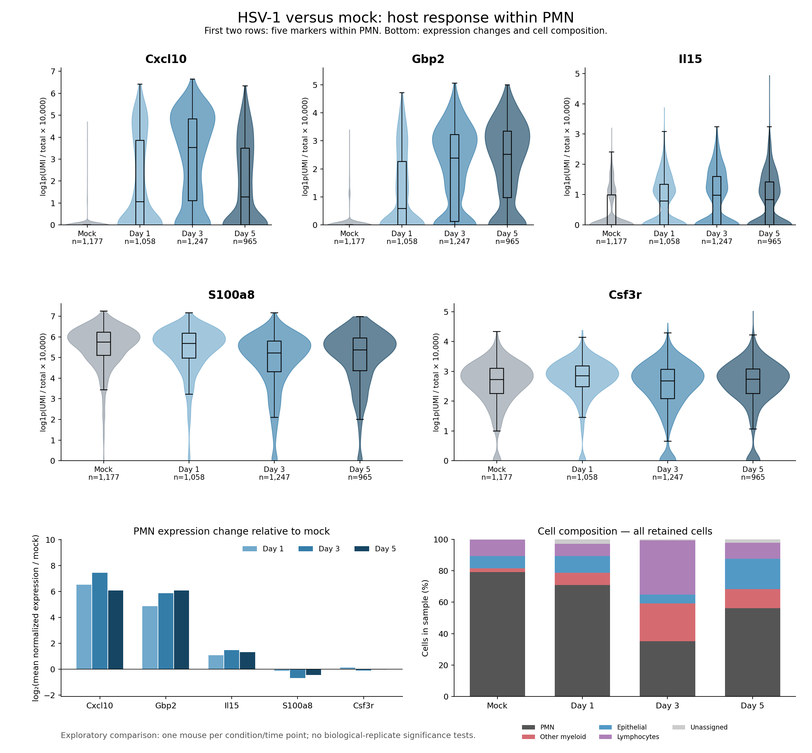

**HSV-2**

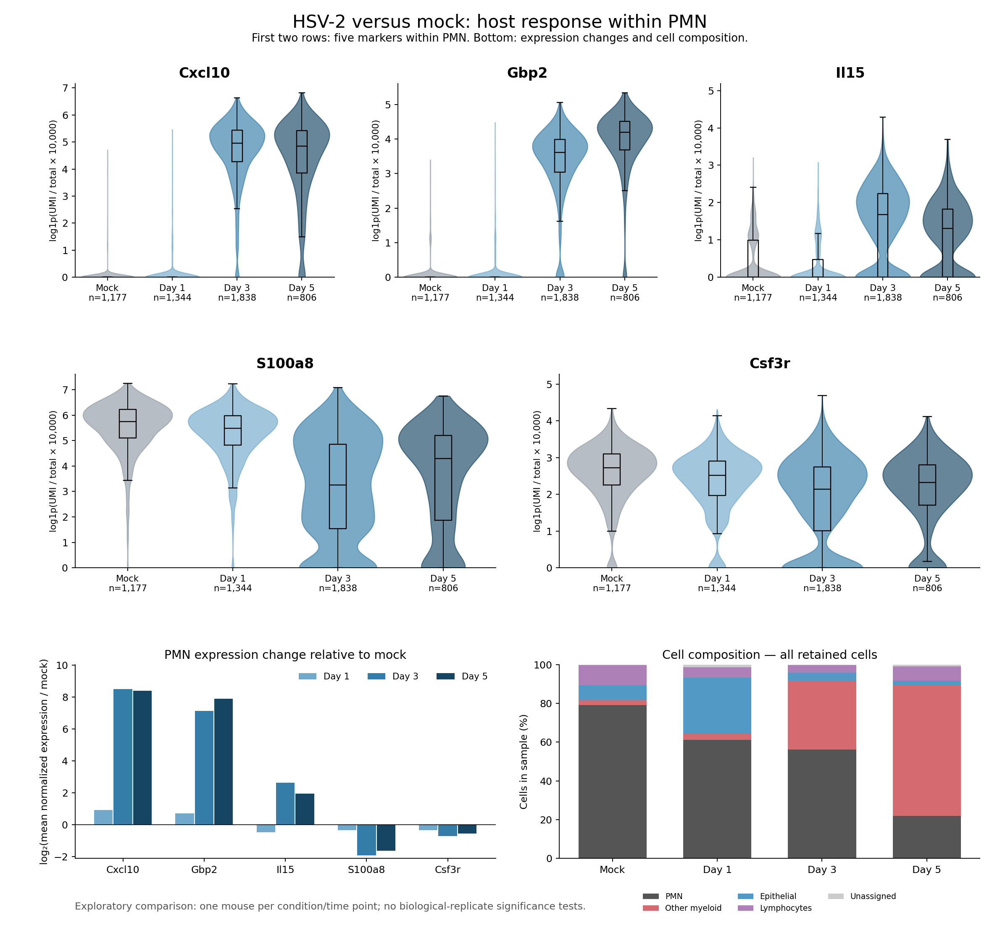

---

## Gap analysis

| Topic | Remaining gap |
|---|---|
| Sample selection and cell count | The Figure 3 legend describes day-5 tissue. This embedding uses all seven deposited samples, with only mock/day-5 cells displayed in C/D. The paper's 21,633 retained cells are not recovered. |
| Cluster-based QC | The paper removes three low-gene clusters but does not specify the cluster statistic or initial clustering settings. Our median-gene rule removes four clusters, retaining 17,380 cells. |
| UMI regression | Negative-binomial regression follows the paper's stated model. In this run, 15 failed fits were handled by Seurat's built-in fallback. |
| Final clustering | Exact PC count and resolution are unspecified. Our selected settings produce 18 clusters versus the paper's 17. Cluster numbers do not directly correspond to the paper. |
| Cell-type annotation | The paper names S100a8/Csf3r for PMN but does not list markers for the other Figure 3A groups. Additional assignments remain provisional. |
| IFN-alpha score | The exact gene-set version, scoring function and control-gene settings are unspecified. Our `AddModuleScore` calculation is an approximation. |
| Viral counts | HSV-2 alignments are present in inspected BAMs, but its matrix feature is zero in all samples, before and after QC. Mock also has viral alignments and nonzero HSV-1 UMI. The causes remain unresolved. |
| Biological replication | One mouse per condition/time point limits inference. Cell-level differences do not establish reproducible differences between animals or track individual cell fates. |
